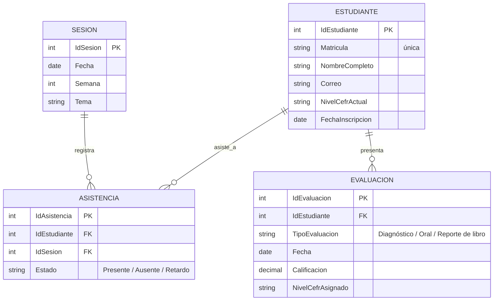

# Sistema de Gestión del Club de Inglés — Universidad de Colima

Aplicación web para que el coordinador del Club de Inglés administre **estudiantes, sesiones, asistencia y evaluaciones** desde una sola base de datos relacional, y para que cada estudiante consulte su propio avance.

**Materias:** Programación Web · Bases de Datos para Internet
**Equipo:** David Alejandro Reyes Andrade e Isai Bueno Ayala — Grupo 3C, FT2026

---

## Tecnologías

| Capa | Tecnología |
|---|---|
| Interfaz web | Blazor (.NET 10, Interactive Server) + Bootstrap |
| Acceso a datos | Entity Framework Core 10 (Code First + migraciones) |
| Base de datos | SQL Server 2022 (en Docker) |
| Inicio de sesión y roles | ASP.NET Core Identity |

---

## Modelo de datos



| Entidad | Tipo | Relación |
|---|---|---|
| `Estudiante` | Entidad fuerte | — |
| `Sesion` | Entidad fuerte | — |
| `Asistencia` | Entidad asociativa | Materializa la relación **N:M** `asiste_a` entre Estudiante y Sesion (un registro por estudiante por sesión) |
| `Evaluacion` | Entidad fuerte | Relación **1:N** `presenta` con Estudiante |

Las tablas del inicio de sesión (`AspNetUsers`, `AspNetRoles`, etc.) las crea ASP.NET Core Identity.

---

## Roles de usuario

| Rol | Puede |
|---|---|
| **Coordinador** | Registrar/editar/borrar estudiantes, sesiones y evaluaciones; tomar asistencia; ver el historial de cualquier estudiante; crear las cuentas de los estudiantes |
| **Estudiante** | Ver solo **Mi avance**: su asistencia y sus evaluaciones |

- La **primera cuenta** que se registra se vuelve Coordinador. Después, el registro público se desactiva.
- Las cuentas de estudiantes las crea el coordinador con el botón **Crear acceso** (página Estudiantes). El sistema muestra una contraseña temporal una sola vez.

---

## Páginas

| Página | Descripción |
|---|---|
| Inicio | Resumen: total de estudiantes y sesiones, asistencia y promedio general, próxima sesión, estudiantes por nivel y alertas (asistencia < 80% o promedio < 70) |
| Estudiantes | CRUD de estudiantes + crear acceso |
| Sesiones | CRUD de las sesiones semanales |
| Asistencia | Pasar lista por sesión (Presente / Retardo / Ausente) |
| Evaluaciones | CRUD de evaluaciones, con filtro por estudiante |
| Historial | Asistencia % y promedio de todos; detalle por estudiante |
| Mi avance | (Estudiante) su propio historial |

---

## Cómo ejecutarlo

### Requisitos
- [.NET 10 SDK](https://dotnet.microsoft.com/download)
- [Docker Desktop](https://www.docker.com/products/docker-desktop/)
- Herramienta de EF Core: `dotnet tool install --global dotnet-ef`

### Pasos

1. **Iniciar SQL Server** (con Docker Desktop abierto):
   ```bash
   ./start-db.sh
   ```
   > En Windows, ejecuta el comando `docker run` que está dentro de `start-db.sh`.

2. **Crear las tablas** (aplica las migraciones):
   ```bash
   dotnet ef database update
   ```

3. **Ejecutar la aplicación:**
   ```bash
   dotnet run
   ```
   Abre la dirección que aparece en la terminal (por ejemplo `http://localhost:5175`).

4. **Crear la cuenta del coordinador:** entra a `/Account/Register` y regístrate (solo funciona cuando todavía no existe ninguna cuenta).

### Datos de prueba
Al iniciar con la base vacía, la aplicación carga automáticamente 10 estudiantes, 12 sesiones (jueves del 3 de septiembre al 19 de noviembre de 2026), 120 registros de asistencia y 30 evaluaciones. Son datos ficticios.

---

## Estructura del proyecto

```
ClubIngles/
├── Data/
│   ├── Models/              # Entidades: Estudiante, Sesion, Asistencia, Evaluacion
│   ├── Migrations/          # Migraciones de EF Core
│   ├── ApplicationDbContext.cs   # DbSets, llaves foráneas y restricciones
│   ├── SeedData.cs          # Datos de prueba y roles
│   └── Roles.cs
├── Components/
│   ├── Pages/               # Páginas Blazor
│   ├── Shared/              # DetalleEstudiante (historial reutilizable)
│   └── Layout/              # Menú lateral (según el rol)
├── Program.cs               # Configuración: EF Core, Identity, roles
├── appsettings.json         # Cadena de conexión a SQL Server
└── start-db.sh              # Inicia SQL Server en Docker
```

> La contraseña de la base de datos en `appsettings.json` y `start-db.sh` es solo para el contenedor local de desarrollo.
